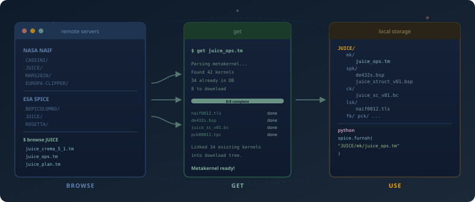

[{fig-alt="Three-panel diagram showing the browse-get-use workflow: browsing NASA NAIF and ESA SPICE servers for metakernels, downloading kernels in parallel, and using the ready metakernel locally with spiceypy."}](images/hero.svg)

## What is this?

`spice-kernel-db` is a tool for getting and managing NAIF SPICE kernels across planetary missions. The primary workflow is: **set up a mission, browse remote metakernels, and get everything you need with one command**.

The tool supports multiple SPICE servers (NASA NAIF and ESA SPICE), downloads kernels in parallel, automatically creates symlinks organized by mission, and generates ready-to-use metakernels. You can browse what's available on remote servers before downloading, and the acquisition process handles all dependencies automatically.

After acquisition, the metakernel is immediately usable — existing kernels already in the database are automatically linked into the download tree so all relative paths resolve correctly. Optional content-addressed deduplication (using SHA-256 hashing) can further reduce storage when working with multiple missions.

## Installation

```bash
pip install spice-kernel-db
```

Or with conda:

```bash
conda install -c michaelaye spice-kernel-db
```

From source:

```bash
git clone https://github.com/michaelaye/spice-kernel-db
cd spice-kernel-db
pip install -e ".[dev]"
```

## Quick taste

```bash
# First run: configure storage path (or re-run with --setup)
spice-kernel-db config

# Add a mission (interactive dialog chooses server and base URL)
spice-kernel-db mission add

# Browse available remote metakernels
spice-kernel-db browse JUICE

# Get kernels from a remote metakernel (parallel downloads, auto-symlink, ready to use)
spice-kernel-db get https://naif.jpl.nasa.gov/pub/naif/JUICE/kernels/mk/juice_crema_5_1.tm

# Use the locally rewritten metakernel with spiceypy
spiceypy.furnsh("/your/storage/path/symlinks/JUICE/juice_crema_5_1.tm")
```

See the [Usage Guide](03-usage.qmd) for the full walkthrough.

## Public API

These are the names `spice_kernel_db` exports, and the list `spice_kernel_db.__all__` carries. They are the stability promise: within a major version they keep their names and the meaning of their arguments, so a dependent such as planetarypy can pin `spice-kernel-db>=0.30,<1`. Everything else in the package (`spice_kernel_db.db`, `.remote`, `.config`, `.cli`) is internal and may change in any release. The [API reference](../reference/index.html) is generated from these names' docstrings.

```python
from spice_kernel_db import (
    # the database
    KernelDB, RegistryRow,
    # one call against the configured database
    check, get, metakernels_covering, register_metakernel, resolve_metakernel, scan,
    # configuration
    Config, ConfigError, ensure_config, kernel_roots, add_root, remove_root,
    # metakernel files
    parse_metakernel, parse_metakernel_text,
    # exceptions
    AmbiguousKernelRoot, AmbiguousMetakernel, ConcurrentModificationError,
    LegacyDatabaseFound, MetakernelNotTracked, MetakernelUnreachableError,
)
```

**Hosting the CLI.** A program with its own Typer CLI mounts skd's command tree as one of its groups with `app.add_typer(spice_kernel_db.cli.app, name=...)` (planetarypy does this as `plp spice`), maps the exceptions that escape its app with `spice_kernel_db.cli.exit_code(exc)` (1 for an untracked metakernel or a concurrent modification, 2 for an ambiguous name or root or an unreachable source, 78 for a config error or a legacy database, `None` for anything that is not skd's), and runs the app inside `spice_kernel_db.cli.logging_to_stderr()`, which prints the library's warnings (INFO under `-v`) as bare lines on stderr for that run only. Those three names are the host contract and change only with a major version; the rest of `spice_kernel_db.cli` is internal.

The library is quiet: no function or method prints unless you hand it a `rich.console.Console` (`KernelDB(console=...)`, `get(console=...)`), and warnings go through the `spice_kernel_db` logger, so a script sees them only if it configures logging. The CLI is this API plus a console and one log handler.
